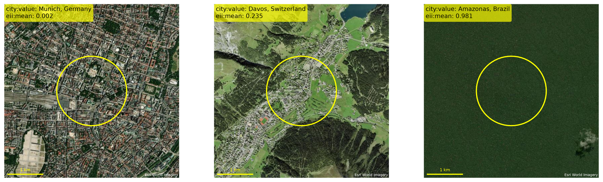

# Ecosystem Integrity Index (EII)

[](https://landler-io.github.io/ecosystem-integrity-index/)
[](LICENSE)
[](https://www.python.org/)

The Ecosystem Integrity Index (EII) is an annual global map of terrestrial ecosystem condition at
300 m. It combines three dimensions of integrity, **function**, **structure** and
**composition**, into one score from 0 to 1, where 1 is a fully intact ecosystem:

- **Functional integrity**: observed net primary productivity (Copernicus) against the potential
  of natural vegetation, modelled from climate, terrain and coastal setting, times a change term
  that compares the pixel's vegetation greenness (MODIS Terra and VIIRS EVI) with its own
  2009-2018 baseline.
- **Structural integrity**: landscape quality from the Human Modification Index, after Hill et
  al. (2026), with a logistic habitat-quality curve calibrated against ESA WorldCover.
- **Compositional integrity**: Biodiversity Intactness of the reference year.

The lowest component caps the index (minimum with fuzzy sum). EII v2.0 covers the reference
years 2021 to 2025. The framework builds on the UNEP-WCMC Ecosystem Integrity Index (Hill et al.
2026, *Ecological Indicators* 190, 115314).



## Installation

The package is installed from GitHub:

```bash
pip install "ecosystem-integrity-index[client] @ git+https://github.com/landler-io/ecosystem-integrity-index"
```

Extras: `[client]` for statistics and raster downloads, `[compute]` for the calculation on your
own numpy arrays, `[training]` for the potential NPP model tools, `[all]` for everything. The
client needs a Google Earth Engine account with a Cloud project.

## Quick start

```python
import ee
from eii.client import get_stats

ee.Authenticate()
ee.Initialize(project="your-gee-project-id")

polygon = ee.Geometry.Rectangle([-60, -10, -55, -5])
stats = get_stats(polygon, reference_year=2024, stats=["mean", "median"])
print(stats["values"]["eii"])
```

The client reads EII v2 by default. `reference_year` (2021-2025) defaults to the latest year;
pass it explicitly so results do not change when a new year is published. `get_zonal_stats`,
`get_raster` and `get_layers` work the same way; see
[Getting Started](https://landler-io.github.io/ecosystem-integrity-index/getting-started/).

### Version 1

EII v1, a single static map, stays available:

```python
from eii.client import get_stats, set_version

get_stats(polygon, version="v1")  # one call
set_version("v1")                 # the rest of the session
```

## Documentation

- [Documentation site](https://landler-io.github.io/ecosystem-integrity-index/): getting
  started, methodology, validation, data and assets, limitations, API reference
- [Methodology report (PDF)](docs/report/eii_v2_methodology.pdf)
- [Changes from v1](https://landler-io.github.io/ecosystem-integrity-index/v1-to-v2/)
- [Example notebooks](notebooks/)
- [Changelog](CHANGELOG.md)

Data: the Earth Engine collection
`projects/landler-open-data/assets/products/eii/v2_0/release/global` (one image per 10° tile and
reference year) and the cloud-optimised GeoTIFFs behind it in
`gs://landler-opendata-gee-assets/products/eii/v2_0/` (Requester Pays). See
[Data & Assets](https://landler-io.github.io/ecosystem-integrity-index/data-assets/).

## Repository structure

```
ecosystem-integrity-index/
├── src/eii/
│   ├── client/        # retrieval of the published layers (Earth Engine)
│   ├── compute/       # the v2 calculation on numpy arrays
│   ├── modulation/    # Natural Capital modulation
│   └── training/      # potential NPP sampling design, validation, model cards
├── pipelines/
│   ├── preprocessing/ # input datasets
│   ├── training/      # potential NPP model and change-term constants, SI curve calibration
│   ├── production/    # global EII run and publication
│   └── validation/    # external validation
├── notebooks/         # example notebooks
└── docs/              # documentation and methodology report
```

## Citation

If you use EII v2, please cite:

> The Landbanking Group (2026). The Ecosystem Integrity Index, version 2: methodology, input data, processing
> and validation. Technical report.
> https://github.com/landler-io/ecosystem-integrity-index/blob/main/docs/report/eii_v2_methodology.pdf

The concept and version 1 are described in:

> Leutner, B. (2025). The Ecosystem Integrity Index: A comprehensive, globally applicable, and
> unified metric for ecosystem health. Technical Whitepaper. The Landbanking Group, Munich,
> Germany. [PDF](https://media.thelandbankinggroup.com/ecosystem-integrity-index-eii.pdf)

## Contributing

Contributions are welcome. See [CONTRIBUTING.md](CONTRIBUTING.md).

## License

The code is licensed under the Apache License 2.0; see [LICENSE](LICENSE). The published data
products (EII tiles, potential NPP map, training tables) are licensed under
[CC BY 4.0](https://creativecommons.org/licenses/by/4.0/), attribution: The Landbanking Group.
They are derived from third-party inputs whose own licence and attribution terms are listed in
[Data & Assets](https://landler-io.github.io/ecosystem-integrity-index/data-assets/#licences).
