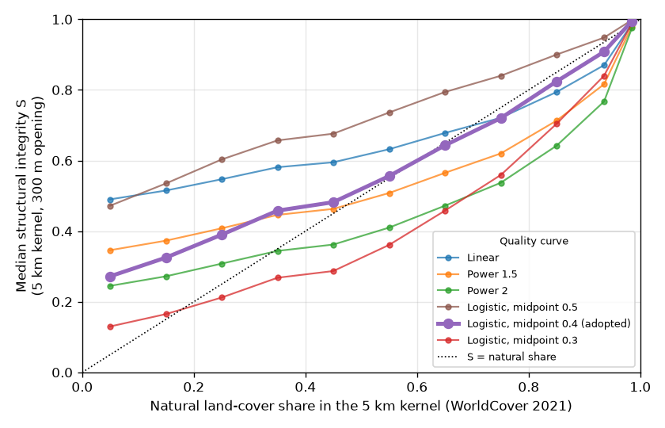
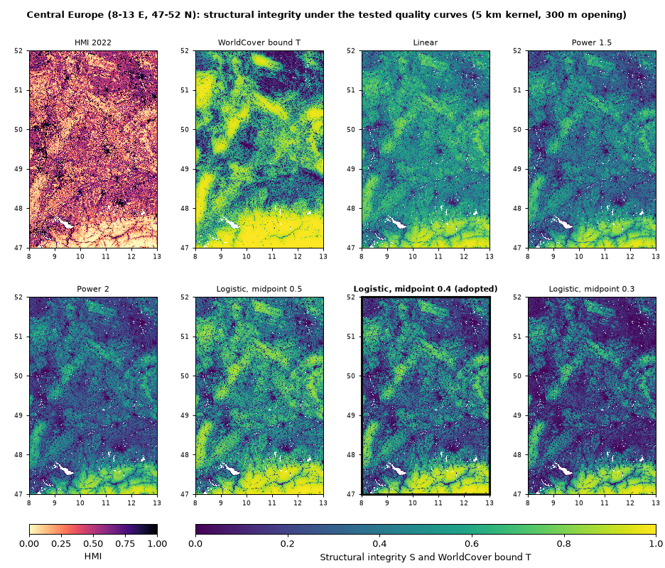

# Structural Integrity

Structural integrity describes how physically intact the land and its surrounding landscape are.
A pixel scores high when it is itself little modified and when the land around it is too: large,
connected areas of natural land score highest. Roads, settlements, farmland and other human
modification lower the score of a pixel and of its neighbours.

## In plain terms

!!! abstract "Structural integrity in one sentence"
    How intact a place is, times how much intact land surrounds it, with nearby land counting
    more than distant land.

Both parts come from the Human Modification Index (HMI). For **natural land**, the score is
roughly the share of natural land around it. For **modified land**, that share is reduced by
the pixel's own condition: a field scores about a third of what natural land at the same spot
would.

**How far "around" reaches.** The land within about 10–20 km counts, and nearer land counts more.
Nothing beyond 26.5 km counts.

| Within | 1 km | 5 km | 10 km | 15 km | 20 km |
|---|---:|---:|---:|---:|---:|
| Share of the neighbourhood's weight | 2 % | 27 % | 61 % | 83 % | 94 % |

**What counts as natural land.** Every pixel counts by its condition, with no cut-off. In the
neighbourhood, lightly used land (HMI 0.2: roads, scattered houses, light grazing) counts as 0.95
of natural land. Farmland (HMI 0.6) counts as 0.35 and built-up land (HMI 0.8) as 0.13. Patches
of natural land narrower than about 600 m, such as hedgerows, tree lines and small woodlots,
score for themselves but do not raise their neighbours' scores.

### Examples

The scores below come from the production code run on simple test landscapes. Natural land has
HMI 0 and farmland HMI 0.6.

| Situation | Score |
|---|---:|
| Natural land inside a large natural area | 1.00 |
| Lightly used land (HMI 0.2) throughout, e.g. extensive grazing | 0.90 |
| Centre of a 30 × 30 km forest in farmland | 0.92 |
| Edge of that forest | 0.66 |
| Field directly outside that forest | 0.22 |
| Centre of a 10 × 10 km forest in farmland | 0.56 |
| Centre of a 2 × 2 km forest in farmland | 0.36 |
| Natural block in a half-natural, half-farmland mosaic of 1.5 km blocks or larger | 0.68 |
| Farmland block in that mosaic | 0.23 |
| Natural strip in the same 50/50 mix arranged as 300 m strips | 0.35 |
| Farmland throughout | 0.12 |
| Built-up land throughout (HMI 0.8) | 0.02 |

What these show:

- **Size matters.** A forest pixel scores near 1 only inside a natural area tens of kilometres
  across. The centre of a 10 km forest surrounded by farmland scores about half.
- **The same amount of habitat can score differently.** Half natural land in 1.5 km blocks gives
  natural pixels 0.68. The same half in 300 m strips gives them 0.35, because strips that narrow
  do not count as habitat for their neighbours.
- **Neighbouring forest helps a field only a little.** A field next to a large forest scores 0.22
  instead of 0.12. A 1 km² wood right next to a field carries well under 1 % of the field's
  neighbourhood weight.

### Is this just HMI?

Partly, and by design. Structural integrity uses no data besides HMI. It reads HMI at two
scales: the pixel itself and its landscape. Here is how much each part matters, on the 29,420
points of the 29,585-point equal-area global sample that have HMI:

- **On modified land** (HMI ≥ 0.1, 30 % of land), the pixel's own HMI explains 88 % of the
  variation in structural integrity. Over farmland the map looks like an HMI map, with
  field-scale detail, because every score is multiplied by the pixel's own condition.
- **On natural land** (HMI < 0.1, 70 % of land), the pixel's own HMI explains only 24 %. The rest
  comes from the landscape. Here structural integrity shows something HMI alone does not: intact
  land inside fragmented land.
- **At the same pixel HMI, the landscape still moves the score.** At HMI 0.4–0.5, the middle
  80 % of points range from 0.29 to 0.56.
- **The landscape part matches an independent map.** On natural land, structural integrity
  explains 43 % of the variation in WorldCover's natural-land share within 5 km. The pixel's own
  HMI explains 9 %.

So structural integrity is HMI in context. It adds where in the landscape modification sits, but
no independent observation of habitat.

### Why the map looks local

Every score is multiplied by the pixel's own condition, so field and settlement boundaries show
at 300 m even though the neighbourhood is wide: only 27 % of its weight lies within 5 km. The
sharp local pattern comes from the pixel's own condition, not from a narrow neighbourhood.

What structural integrity does not see, such as degradation that HMI does not map, is listed under
[Limitations](#limitations).

## Data: Human Modification Index

The input is the Global Human Modification (GHM) map for 2022 at 300 m (Theobald 2024,
doi:10.5281/zenodo.14502573), which extends the method of Theobald et al. (2020). HMI combines built-up land, agriculture, transport, energy and
extraction, human population and other pressures into a score from 0 (unmodified) to 1 (fully
modified). Its 2022 edition is used for every reference year.

## Method

Each pixel is scored by its own habitat quality and by the quality of the landscape around it,
following Hill et al. (2026), who apply the landscape-intactness measure of Beyer et al. (2020)
to human modification. With habitat quality $w = q(\mathrm{HMI})$ (see
[Habitat quality](#habitat-quality)):

$$S_i = \sqrt{w_i} \cdot \frac{\sum_j K_{ij} \sqrt{w'_j}}{\sum_j K_{ij}}, \qquad
K_{ij} = e^{-d_{ij} / 5\,\mathrm{km}} \ \text{for}\ d_{ij} \le 26.5\,\mathrm{km}$$

- **Site term** $\sqrt{w_i}$: the pixel's own quality. Fully modified land (HMI 1) scores 0
  whatever surrounds it.
- **Landscape term**: the kernel-weighted mean of $\sqrt{w'}$ around the pixel, the pixel itself
  included. Beyer et al. weight every pair of pixels by $(w_i w_j)^z$ with $z = 0.5$; with a
  normalised kernel this is the product above.
- **Kernel**: exponential decay with $\beta$ = 0.2 km⁻¹ (scale 5 km), cut at 26.5 km, the 99.5 %
  quantile of the exponential distance. Nearby land counts most: half of the kernel weight lies
  within about 8 km.
- **Grey opening**: $w'$ is $w$ after a morphological grey opening with a 300 m ground disk, in
  the landscape term only. Patches of good land narrower than about 600 m, such as a single tree
  islet in farmland, add nothing to the landscape term of their neighbours; the islet keeps its
  own site term. Larger patches contribute fully.

Uniform land of HMI $h$ scores $q(h)$. There is no habitat threshold and no quality class, so the
score changes smoothly along a modification gradient.

### Habitat quality

Quality is a logistic curve in HMI, rescaled to 1 at HMI 0 and 0 at HMI 1:

$$q(h) = \frac{L(h) - L(1)}{L(0) - L(1)}, \qquad L(h) = \frac{1}{1 + e^{10\,(h - 0.4)}}$$

| HMI | 0.1 | 0.2 | 0.3 | 0.4 | 0.5 | 0.6 | 0.7 |
|---|---:|---:|---:|---:|---:|---:|---:|
| $q$ | 0.97 | 0.90 | 0.74 | 0.51 | 0.27 | 0.12 | 0.05 |
| $1 - \mathrm{HMI}$ (Hill et al. 2026) | 0.90 | 0.80 | 0.70 | 0.60 | 0.50 | 0.40 | 0.30 |

Lightly used land (roads, scattered settlement, extensive grazing; HMI below about 0.2) keeps
nearly full quality. Quality falls steeply between HMI 0.3 and 0.5, where agriculture and
settlement replace natural cover, and land above HMI 0.6 contributes little. The curve was
calibrated against WorldCover land cover ([Calibration](#calibration-of-the-quality-curve)).

### Parameters

| Parameter | Value | Source |
|---|---|---|
| Quality | logistic in HMI, midpoint 0.4, steepness 10 | calibrated against WorldCover 2021 |
| Pairwise exponent $z$ | 0.5 | Beyer et al. (2020) |
| Kernel scale | 5 km ($\beta$ = 0.2 km⁻¹) | Beyer et al. (2020) |
| Kernel radius | 26.5 km | Beyer et al. (2020), 99.5 % quantile |
| Opening radius | 300 m | keeps small isolated patches out of the landscape term |

Hill et al. (2026) use the same kernel on a 1 km grid with a 27 km window and the linear quality
$1 - \mathrm{HMI}$. Beyer et al. (2020) use $e^{-0.402\,\mathrm{HFI}}$ on the 0-50 Human
Footprint, which gives moderately modified land almost no quality.

## Calibration of the quality curve

There is no measured ground truth for structural integrity, so the curve was chosen against an
independent bound: natural land cover from ESA WorldCover 2021. For each 300 m HMI pixel, $n$ is
the share of natural classes (tree cover, shrubland, grassland, bare or sparse vegetation, snow
and ice, herbaceous wetland, mangroves, moss and lichen; open water excluded). Applying the same
formula to $n$ instead of $w$ gives $T = \sqrt{n_i}\,\overline{\sqrt{n}}$, a structural score based
on land cover. WorldCover counts pasture, meadows and plantations as natural, so $T$ overstates
habitat, never understates it: **structural integrity should not systematically exceed $T$**.

Six quality curves (linear, $(1-\mathrm{HMI})^{1.5}$, $(1-\mathrm{HMI})^2$, logistic with midpoint
0.5, 0.4 and 0.3), three kernel scales (2.5, 5, 10 km) and two openings (300 m, 1 km) were scored
at the equal-area points of the global sample (29,585 points, 29,420 of them with HMI). The
figures in this section come from internal calibration diagnostics that are not part of this
repository. Two criteria were fixed beforehand: the median score per biome and per anthrome (Ellis
land-use class) may not exceed the median of $T$ by more than 0.05, and wild land with at least
95 % natural cover must keep a median of at least 0.95. The gentlest curve passing both was
adopted.



The figure shows median $S$ against the share of natural land cover within the kernel. The
adopted logistic curve with midpoint 0.4 follows the natural share from about 0.3 to 0.8, stays
above it where natural cover is scarce (the safe side, since WorldCover overcounts habitat) and
keeps near-natural landscapes near 1. It puts the steep part where the habitat-amount literature
puts fragmentation thresholds, at 20-40 % habitat (Andrén 1994; Fahrig 2003). The linear curve
$1 - \mathrm{HMI}$ has a floor: a landscape with under 10 % natural cover scores 0.49, and $S$
rises only to 0.87 across the whole range of habitat amount, so converted landscapes look half
intact. Two thirds of land lies in landscapes with at least 97 % natural cover, so global and
biome averages hide this floor. The linear curve and the logistic with midpoint 0.5 exceed the
bound in village landscapes (linear: median 0.53 against 0.43). The power curves stay within the
bound but penalise near-natural landscapes ($(1-\mathrm{HMI})^2$ gives 0.77 at 90-97 % natural
cover).

| Natural share in kernel | < 10 % | 20-30 % | 40-50 % | 60-70 % | 80-90 % | 90-97 % | ≥ 97 % |
|---|---:|---:|---:|---:|---:|---:|---:|
| Points | 194 | 571 | 683 | 842 | 1,660 | 2,570 | 19,751 |
| Median $S$, linear | 0.49 | 0.55 | 0.60 | 0.68 | 0.79 | 0.87 | 0.99 |
| Median $S$, logistic 0.4 | 0.27 | 0.39 | 0.48 | 0.64 | 0.82 | 0.91 | 1.00 |

**Kernel scale and opening do not set the level.** Mean $S$ changes by at most 0.002 between 2.5 and 10 km for any curve. A wider kernel leaves
natural pixels inside farmland unchanged and slightly raises farmland next to natural land. A
1 km opening lowers $S$ by about 0.02, a tenth of the effect of the curve. Both stay at their
Beyer et al. values.

**Effect on the EII.** The logistic curve spreads the scores rather than lowering them
everywhere. In the global run (2024), the 10th percentile of $S$ is 0.49 and the median 0.98
(0.60 and 0.96 under $1 - \mathrm{HMI}$). Land below HMI 0.3, such as most rangelands, keeps
nearly full quality, while village and settlement landscapes score lowest (median EII 0.32 and
0.27). On the sample (2024), mean EII in Europe is 0.54, and structure is the limiting
component on 71 % of European land where some component is below 0.9. Functional integrity is near 1 on most land and does not separate cropland from
natural land, so structure is the component that carries long-standing conversion; a large share
limited by structure is intended.



### Interpretation

| Score | Example |
|---|---|
| 1.0 | Unmodified pixel in an unmodified landscape |
| 0.74 | Uniform landscape at HMI 0.3 (lightly farmed mosaic) |
| 0.27 | Uniform landscape at HMI 0.5 (arable land with settlements) |
| 0.0 | Fully modified pixel (HMI 1), whatever its surroundings |

### Configuration

The kernel mean measures how much quality lies near a pixel and how close it is, not how it is
arranged. The $z = 0.5$ product rewards pixels that are good *and* surrounded by good land, so an
unmodified pixel in farmland scores lower than one inside a forest. The opening adds one rule about
arrangement at fine scale: patches narrower than about 600 m do not raise their neighbours'
scores. Two landscapes with the same share of natural land arranged as one block or as 300 m
fragments therefore differ. Because the kernel weights land by distance, two blocks 10 km apart
also score differently from one block of their combined size.

## Masks and implementation

`eii.compute.structural_integrity` works on HMI on its native ~300 m EPSG:4326 grid
([API](../api/compute.md)).

- Kernels are circles on the ground: their east-west radius in pixels grows with 1/cos(latitude),
  evaluated per 0.5° latitude strip.
- Pixels without HMI (sea, lakes, no data) do not enter the kernel mean, are not opened away from
  coastal land, and stay masked in the output.
- The global run computes each 10° tile with a halo of 26.8 km (kernel radius plus opening) and
  resamples the result bilinearly onto the CLMS NPP grid.

```python
import numpy as np
from eii.compute import structural_integrity

hmi = np.full((200, 200), 0.3, dtype="float32")
s = structural_integrity(hmi, top_lat=48.0, pixel_deg=1 / 336)
float(s[100, 100])  # 0.74, habitat_quality(0.3)
```

## Limitations

- Structural integrity uses no data besides HMI. On modified land it largely follows the pixel's
  own HMI; it adds the landscape context ([Is this just HMI?](#is-this-just-hmi)).
- The score measures habitat quality and its amount near each pixel, not functional connectivity:
  whether organisms can move between patches depends on species-specific dispersal.
- HMI measures pressure, not habitat. Low-pressure land that is not natural habitat, such as
  extensive pasture, counts by its quality $q(\mathrm{HMI})$, and small natural features inside
  high-HMI pixels are invisible.
- Degradation that HMI does not map, such as selective logging and forest edges in the moist
  tropics, is not seen; structural integrity of tropical forest is therefore high. WorldCover
  cannot bound it either, because it counts plantations as tree cover.
- The curve is calibrated against an upper bound, not a measured target. Its midpoint is a
  judgement within the range the bound allows.
- HMI 2022 is used for every reference year, so structural integrity does not register change
  after 2022.
- The kernel does not wrap across the antimeridian: land beyond 180° is treated as no data, which
  affects eastern Russia and Fiji within 26.5 km of the line.

## References

- Andrén, H. (1994). Effects of habitat fragmentation on birds and mammals in landscapes with
  different proportions of suitable habitat: a review. *Oikos*, 71, 355-366.
- Beyer, H. L., Venter, O., Grantham, H. S., & Watson, J. E. M. (2020). Substantial losses in
  ecoregion intactness highlight urgency of globally coordinated action. *Conservation Letters*,
  13, e12692.
- Fahrig, L. (2003). Effects of habitat fragmentation on biodiversity. *Annual Review of
  Ecology, Evolution, and Systematics*, 34, 487-515.
- Hill, S. L. L., et al. (2026). The ecosystem integrity index: a component indicator in the
  Kunming-Montreal global biodiversity framework reveals the integrity of terrestrial ecosystems
  globally. *Ecological Indicators*, 190, 115314.
- Theobald, D. M. (2024). Global human modification datasets of terrestrial ecosystems for 2022.
  Zenodo, doi:10.5281/zenodo.14502573.
- Theobald, D. M., et al. (2020). Earth transformed: detailed mapping of global human
  modification from 1990 to 2017. *Earth System Science Data*, 12, 1953-1972.
- Zanaga, D., et al. (2022). ESA WorldCover 10 m 2021 v200. Zenodo,
  doi:10.5281/zenodo.7254221.
