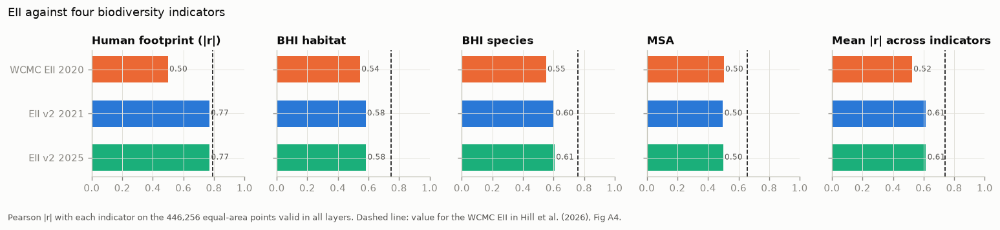
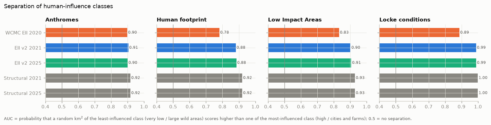
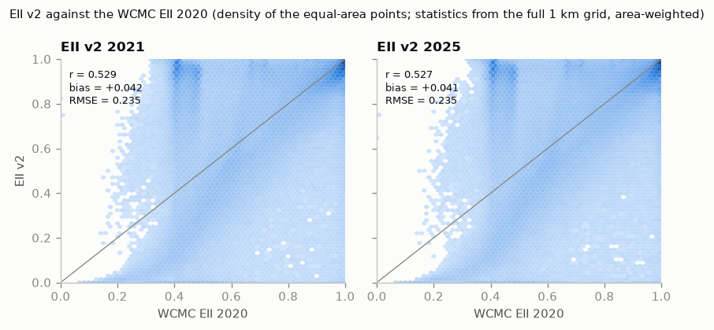
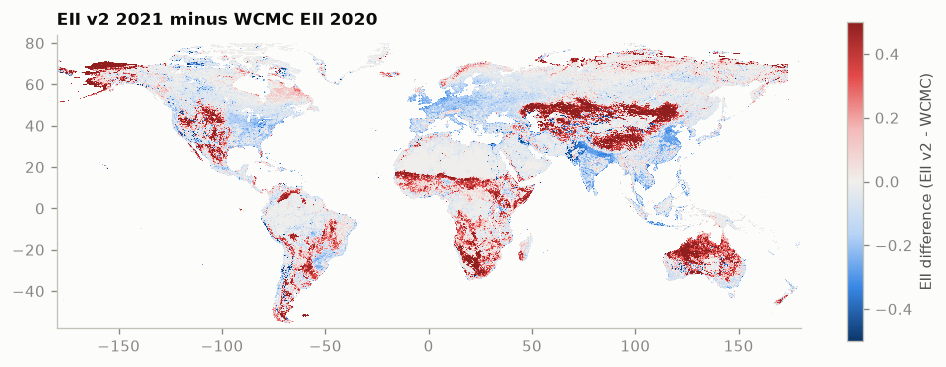
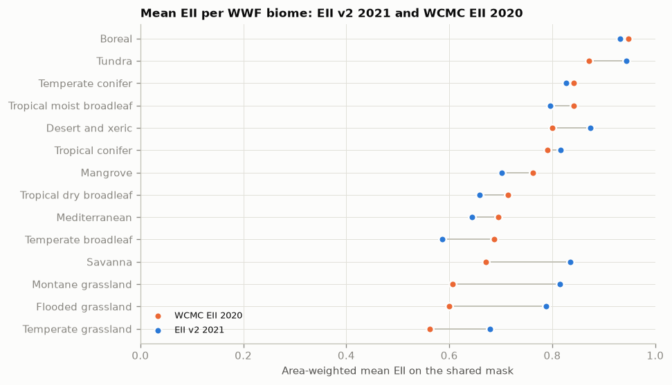

# Validation

EII has no direct ground truth: nobody measures ecosystem integrity in the field at global
scale. Validation therefore checks three things:

1. how well the potential NPP model predicts NPP at natural sites it has not seen;
2. whether functional integrity responds to known land use and loss without flagging intact land;
3. how the global index and its three components agree with independent maps of human
   pressure and biodiversity, and with the EII published by UNEP-WCMC.

The second part uses the design of the cross-indicator validation in Hill et al. (2026,
supplement section A2), so our numbers can be read next to the values they report for their
own index. All numbers below are descriptive; no pass/fail thresholds are applied.

Code, input sources and the full result tables:
[`pipelines/validation`](https://github.com/landler-io/ecosystem-integrity-index/tree/main/pipelines/validation)
(tables and figures in its
[`outputs`](https://github.com/landler-io/ecosystem-integrity-index/tree/main/pipelines/validation/outputs)
folder). The [methodology report](../report/eii_v2_methodology.pdf) carries the same results in
citable form.

## 1. Potential NPP model

Out-of-fold scores on 30,000 stratified reference sites (full tables on the
[model page](potential_npp.md#skill)):

| Test | R² | Within-block R² | Pooled bias |
|---|---|---|---|
| 4° block CV, 1° buffer | 0.906 | 0.497 | 0.0 % |
| Leave-realm-out | 0.861 | 0.412 | +0.4 % |

The 68 % prediction interval covers 0.67-0.68 of held-out sites under block CV in every biome,
and 0.64 to 0.74 when a whole realm is held out.

## 2. Functional integrity on land of known state

The published maps of 2021 and 2025 at the same 500,000 points, each a 3 x 3 box of 300 m pixels
(report section "The published product"). A box is flagged when its mean score is below 0.75.

| Test (2021 / 2025) | FI_state | FI |
|---|---|---|
| Wild land, biomes with 10th percentile ≥ 0.75 | 8/8, 8/8 | 7/8, 7/8 (montane grassland fails) |
| Synthetic 40 % NPP loss on intact land, share flagged | 0.37 / 0.36 | |
| Deficit false alarms on intact land | 3.5 % / 2.9 % | |
| Forest boxes with > 60 % recent Hansen loss, share flagged | 5.7 % / 8.8 % | 22.9 % / 30.2 % |
| AUC, > 60 % loss vs undisturbed forest | 0.66 / 0.71 | 0.90 / 0.92 |
| Undisturbed forest boxes flagged | 0.5 % / 0.4 % | 0.5 % / 0.4 % |

FI_state flags a minority of real forest loss; the change term raises detection three- to
four-fold. Within-biome correlation with human influence stays weak (median Spearman -0.09 to
-0.10), and cropland scores below semi-natural woodland in only 5-7 of 11 biomes: annual NPP does
not separate many conversions.

## 3. The global index

### Design

- **Product.** EII v2 for reference years 2021 and 2025. 2021 is compared with the WCMC EII
  2020, the latest year WCMC publishes.
- **Sampling.** All layers are aggregated to a 1 km equal-area grid (Eckert IV) by the mean of
  valid pixels. Correlations use 500,000 equal-area random land points (seed 42); area
  summaries use every 1 km² cell.
- **WCMC comparison.** Our EII is aggregated to the WCMC grid (EPSG:4326, about 1 km) and
  compared on every cell where both products have a value (97 % of the land either covers),
  weighted by cell area.
- **Independent layers.** Human footprint (WCS Human Influence Index 2013, standing in for the
  Williams et al. 2020 layer used by Hill et al.), Biodiversity Habitat Index (BHI v2,
  habitat and species, 2015, modelled with CSIRO's BILBI framework), Mean Species Abundance
  (GLOBIO4, 2015), ecoregion intactness (Beyer et al. 2020), anthromes (Ellis et al.), Low
  Impact Areas (Jacobson et al. 2019), the Locke et al. (2019) global conditions, nature's
  contributions to people (Chaplin-Kramer et al. 2019), soil organic carbon (GSOCmap) and the
  defaunation index for the tropics (Benítez-López et al. 2019).

The four indicators correlate with each other as in the paper (pairwise r within 0.03 of the
published values), which indicates that the sampling reproduces their design.

### Correlation with biodiversity indicators

Pearson r on the 446,256 points valid in all layers:

| | Human footprint | BHI habitat | BHI species | MSA | Mean abs. r |
|---|---|---|---|---|---|
| EII v2, 2021 | -0.77 | 0.58 | 0.60 | 0.50 | 0.613 |
| EII v2, 2025 | -0.77 | 0.58 | 0.61 | 0.50 | 0.615 |
| WCMC EII 2020, published raster | -0.50 | 0.54 | 0.55 | 0.50 | 0.524 |
| Hill et al. (2026), reported | -0.79 | 0.75 | 0.76 | 0.66 | 0.740 |

EII v2 tracks the human footprint closely and agrees with BHI and MSA about as well as the
published WCMC raster does. The values Hill et al. report for their index are higher than
those of their published raster on the same points; the published raster is the reference
used here.

Ecoregion means of EII against ecoregion intactness (789 ecoregions with at least 100 km²):
Pearson r 0.51, Spearman 0.80 (WCMC EII 2020: 0.41 / 0.56; Hill et al. report r = 0.84).

### Separation of human-influence classes

AUC: the probability that a random km² of the least-influenced class scores higher than one of
the most-influenced class (0.5 = no separation, 1 = complete separation). Full grid, 2021.

| Classification (least vs most influenced) | EII v2 | Structural only | WCMC EII 2020 |
|---|---|---|---|
| Anthromes (wild vs used) | 0.905 | 0.917 | 0.898 |
| Human footprint (0 vs > 3) | 0.881 | 0.921 | 0.781 |
| Low Impact Areas (very low impact vs outside) | 0.902 | 0.929 | 0.832 |
| Locke et al. (large wild areas vs cities and farms) | 0.989 | 0.999 | 0.887 |

The 2025 map gives the same values to within 0.005. EII separates heavily used from wild land
more sharply than the WCMC EII on all four classifications. Structural integrity alone
separates the classes slightly better than EII, as expected: the classifications are built
from the same kind of land-use information, while functional and compositional integrity can
lower EII on land these maps class as wild.

### Components

| | Value (2021) | Hill et al. (2026) |
|---|---|---|
| Structural vs compositional, r | 0.90 | 0.54 |
| Structural vs functional, r | 0.19 | 0.10 |
| Compositional vs functional, r | 0.18 | 0.09 |
| Limiting component: compositional / structural / functional | 52 % / 32 % / 16 % of sample points, components at 1 km | |

Structural and compositional integrity are strongly correlated because both respond to land
conversion. Functional integrity is nearly independent of both and sets EII on one point in six,
so it adds information the other two do not carry.

**Compositional integrity** against biodiversity layers (Pearson r, 2021): BHI species 0.66,
BHI habitat 0.63, MSA 0.56, retained fauna from the defaunation index 0.55 (112,722 tropical
points). Hill et al. report 0.52, 0.44 and 0.23 for BHI, MSA and defaunation.

**Functional integrity** against nature's contributions and soil carbon (Pearson r, 2021):
pollination -0.10, nutrient retention potential -0.08, nitrogen retention -0.06, nutrient
delivery ratio -0.06, soil organic carbon 0.05. Hill et al. also find no relationship (|r| ≤
0.06). These layers measure how much a service is supplied, not whether the land functions as
it would without human pressure, so a weak relationship is expected.

### Comparison with the WCMC EII

Our EII 2021 against the published WCMC EII 2020, on every shared 1 km cell, area-weighted:

| Measure | EII v2 2021 | EII v2 2025 |
|---|---|---|
| Pearson r (area-weighted) | 0.529 | 0.527 |
| Spearman rho (equal-area sample, n = 447,577 / 447,661 valid of 500,000) | 0.592 | 0.579 |
| Mean difference, ours minus WCMC | +0.042 | +0.041 |
| Mean absolute difference | 0.154 | 0.155 |
| RMSE | 0.235 | 0.235 |
| 1st / 99th percentile of the difference | -0.48 / +0.59 | -0.48 / +0.59 |
| Share of area differing by more than 0.2 | 0.29 | 0.29 |
| Mean EII on the shared mask (WCMC 0.763) | 0.805 | 0.804 |

Both products agree on wild land: the densest part of the scatter lies near (1, 1). The
differences are regional and systematic. EII v2 is higher on drylands and rangelands
(Australia, the Sahel, southern Africa, the Central Asian steppe, the western United States,
Patagonia) and in the Arctic tundra; WCMC places large areas of rangeland at 0.40-0.46, which
shows as the vertical band in the scatter. EII v2 is lower in the farmed and settled temperate
broadleaf regions (Europe, the eastern United States, eastern China) and in India, where its
structural component scores cropland and settlements lower.

Per WWF biome (2021, shared mask, area-weighted):

| Biome | WCMC 2020 | EII v2 2021 | Difference | Mean abs. difference | r |
|---|---|---|---|---|---|
| Tropical moist broadleaf | 0.841 | 0.796 | -0.046 | 0.082 | 0.88 |
| Tropical dry broadleaf | 0.714 | 0.658 | -0.055 | 0.115 | 0.86 |
| Tropical conifer | 0.791 | 0.815 | +0.024 | 0.136 | 0.43 |
| Temperate broadleaf | 0.688 | 0.587 | -0.101 | 0.134 | 0.90 |
| Temperate conifer | 0.841 | 0.827 | -0.014 | 0.123 | 0.49 |
| Boreal | 0.948 | 0.932 | -0.016 | 0.060 | 0.49 |
| Savanna | 0.671 | 0.835 | +0.164 | 0.213 | 0.37 |
| Temperate grassland | 0.562 | 0.679 | +0.117 | 0.242 | 0.13 |
| Flooded grassland | 0.599 | 0.789 | +0.189 | 0.280 | 0.27 |
| Montane grassland | 0.607 | 0.814 | +0.207 | 0.311 | 0.07 |
| Tundra | 0.871 | 0.944 | +0.073 | 0.148 | 0.04 |
| Mediterranean | 0.695 | 0.644 | -0.051 | 0.126 | 0.78 |
| Desert and xeric | 0.800 | 0.873 | +0.074 | 0.171 | 0.40 |
| Mangrove | 0.762 | 0.702 | -0.060 | 0.122 | 0.84 |

Agreement is high in forest biomes with a clear gradient from intact to converted land
(tropical, temperate broadleaf, Mediterranean, mangrove: r 0.78-0.90). It is low in grassland,
savanna, tundra and desert, where the two products judge grazing land and sparse vegetation
differently.

Across the 415 World Terrestrial Ecosystems (Sayre et al. 2020), with each product averaged on its
own valid mask, the mean of ecosystem means is similar (EII v2 0.678, WCMC 0.689), but EII v2 spreads them more
widely (standard deviation 0.30 against 0.20): 59 ecosystems average 0.25 or less in EII v2,
7 in the WCMC EII. Tables per ecoregion and per ecosystem are in the outputs folder.

**Attribution.** The result tables contain values derived from third-party data: per-biome,
per-ecoregion and per-ecosystem means of the UNEP-WCMC EII 2020 (Hill et al. 2026; CC BY 4.0) and
per-ecoregion means of the ecoregion intactness of Beyer et al. (2020; CC BY 4.0). The other
independent layers enter the tables only as correlations and area summaries; the layers
themselves are not redistributed.

## What has not been validated

- Plot-level accuracy: there is no global set of field measurements of integrity.
- Functional integrity on non-forest degradation (rangeland, drought die-off), for which no
  independent reference data were available. The response of the change term to observed
  disturbance is described on the [functional integrity page](functional_integrity.md#change-term).
- Change over time: the WCMC EII ends in 2020 and the independent layers are single epochs
  (2000-2015), so year-to-year changes of EII are not compared with an external series.
- The potential model on the four smallest biomes with a full leave-biome-out test; the
  leave-realm-out results stand in.
- The Red List of Ecosystems for South Africa, part of the Hill et al. design, could not be
  obtained and is not included.

## References

- Hill, S. L. L. et al. (2026). The ecosystem integrity index: a component indicator in the
  Kunming-Montreal global biodiversity framework reveals the integrity of terrestrial
  ecosystems globally. Ecological Indicators 190, 115314.
- Beyer, H. L. et al. (2020). Substantial losses in ecoregion intactness highlight urgency of
  globally coordinated action. Conservation Letters 13, e12692.
- Benítez-López, A. et al. (2019). Intact but empty forests? Patterns of hunting-induced
  mammal defaunation in the tropics. PLoS Biology 17, e3000247.
- Chaplin-Kramer, R. et al. (2019). Global modeling of nature's contributions to people.
  Science 366, 255-258.
- Jacobson, A. P. et al. (2019). Global areas of low human impact ('Low Impact Areas') and
  fragmentation of the natural world. Scientific Reports 9, 14179.
- Locke, H. et al. (2019). Three global conditions for biodiversity conservation and
  sustainable use. National Science Review 6, 1080-1082.
- Sayre, R. et al. (2020). An assessment of the representation of ecosystems in global
  protected areas using new maps of World Climate Regions and World Ecosystems. Global
  Ecology and Conservation 21, e00860.
