# Changes from v1 to v2

Version 2 is a major overhaul of the EII methodology. The idea stays the same: an ecosystem is
scored on how well it functions, how intact its landscape is and how much of its original species
community remains, and the weakest of the three sets the index. Almost everything underneath has
been rebuilt to fix problems found in v1. The five most important:

1. **Intact ecosystems scored as degraded.** v1 judged function by comparing the plant growth seen
   by satellites with a model's estimate of natural growth, and counted every difference as damage,
   including the model's own error. Even untouched land rarely scored above 0.8, and function was
   the deciding component on three quarters of natural land. v2 accepts differences within the
   model's known uncertainty and the normal year-to-year variation of nature, so intact land scores
   1 for function.
2. **Farmland could not be told apart.** v1 counted land as habitat only below a fixed level of
   human pressure, so most agricultural land scored close to 0 for structure, whether it was an
   intensive monoculture or a mosaic of fields, hedges and woodland. v2 lets habitat quality decline
   gradually with human pressure, so differences within modified landscapes become visible.
3. **One map, no change over time.** v1 was a single static map. v2 has one map per reference
   year from 2021 to 2025. Plant growth is the mean of the three years ending in the reference
   year, and species composition is that of the reference year itself. A new change signal
   compares each place's greenness over the same three years with its own fixed 2009-2018
   baseline to pick up clearing, fire and dieback.
4. **Inconsistent satellite data.** The plant growth record used in v1 mixed several product
   versions and a change of satellite, which made some regions look more or less productive for
   technical reasons alone. v2 uses one consistent reprocessed record and corrects slow drifts in
   it.
5. **A natural-growth model that learned from land use.** Some of v1's model inputs, and the map
   coordinates, partly reflect today's land use, so the model could treat degradation as natural.
   v2 uses a new model whose inputs were each tested for this leakage, with lower bias between
   ecosystem types and an uncertainty range calibrated on sites held out from training.

As a result, v2 scores are higher almost everywhere (median EII 0.92 against 0.63 at the same
points), and farmland now spans a range instead of sitting near 0, while built-up land stays
close to 0. Each map now also states which of the three components limits the score. The
sections below give the details.

This page lists the changes and the reasons behind them. The rest of the documentation
describes v2 only; v1 remains available through the client with `version="v1"`.

## Summary

| | v1 | v2 |
|---|---|---|
| Release | One static map | Annual maps for 2021-2025 |
| Computation | Earth Engine, on request or exported | Per 10° tile on fixed inputs; COGs registered as Earth Engine collections |
| Observed NPP | CLMS NPP 2022-2024, older collection mixing product versions | CLMS DMP V2.0.2 (consolidated reprocessing), Sentinel-3 OLCI years only, 3-year window per reference year |
| Potential NPP model | Earth Engine random forest, 10 predictors, trained on the 2014-2024 mean | Global LightGBM (Tweedie) with bias correction, 15 predictors, trained on the 2019-2025 mean |
| Predictors | Climate, aridity, CHELSA NPP, sand, clay, latitude, longitude | Climate, aridity, CHELSA NPP, terrain, coastal setting |
| Uncertainty | Standard deviation classifier | Calibrated 68 % and 90 % intervals per biome; natural inter-annual CV |
| Functional score | 2/3 magnitude (ratio and absolute difference) + 1/3 seasonality | State score: two-sided deviation beyond a tolerance from model uncertainty and natural variability, potential recentred per biome and window; times a change term from MODIS Terra and VIIRS EVI against the pixel's 2009-2018 baseline |
| Structural score | Quality-weighted core habitat (HMI < 0.4, 300 m erosion, four classes) in a 5 km disk | Landscape quality of Hill et al. (2026) with a logistic quality curve in HMI (midpoint 0.4), exponential kernel of 5 km cut at 26.5 km, 300 m opening |
| Compositional input | Biodiversity Intactness 2017-2020 (Earth Blox) | Biodiversity Intactness v1.1, 2017-2025, same year as the reference year |
| Missing data | Missing structural input scored 0 | Any missing component masks EII; BII clamped to [0, 1] |
| Land mask | MODIS water mask | Extent of the potential NPP map (MERIT DEM land) |
| New bands | | `limiting_component`, `wetland_flag`, `fi_state`, `fi_change`, `fi_change_sensors` |
| Aggregation | Minimum × fuzzy sum | Unchanged |

## Observed NPP

**What changed.** v2 reads the consolidated CLMS DMP V2.0.2 reprocessing and uses OLCI years
only, from 2019. Each reference year averages the three annual sums ending in it.

**Why.** The older CLMS collection held up to three product versions of the same dekad and mixed
PROBA-V and OLCI processing. In V2.0.2, the change from PROBA-V to OLCI at 2019 has no overlap
and steps by +26 % in tundra, +18 % in boreal and +11 % in tropical moist forest against MODIS, in
a seasonal pattern that one factor per biome cannot correct. Restricting to OLCI years removes the
break. A reference year 2020 would rest on two OLCI years only (2019 and 2020) and agreed less
well with the human-pressure indicators than later years in an earlier validation, so the
published series starts in 2021.

The storage scale of annual NPP is documented and set in the metadata: stored values are
gC m⁻² yr⁻¹ × 10,000 (`scale_factor = 0.0001`).

## Potential NPP model

**What changed.**

- **Predictors.** Sand, clay, latitude and longitude are removed; terrain (elevation, CTI, TPI,
  aspect) and a coastal group (distance to coast, tidal range, salinity, upstream area) are added.
  Every candidate was tested for skill and for land-use leakage. Soil pH was tested and left out:
  SoilGrids maps it from covariates that include tree cover and MODIS vegetation indices, and it
  responds to liming. Slope was left out after it produced a terrain artefact in Bavaria.
- **Model.** A global LightGBM with Tweedie loss takes the place of the random forest, followed
  by a global bias correction (c = 1.020). Compared on a preliminary training table, pooled
  skill is almost identical (block-CV R² 0.895 against 0.892), but the worst per-biome deficit
  falls from 0.37 to 0.12. The final model reaches block-CV R² 0.906.
- **Training sites.** A global candidate pool at 30 arc-seconds with 142,480 reference sites
  (strict protection, or maximum HMI 1990-2020 below 0.1 and away from modified land), thinned to
  2 km, with bare land kept and cropland, built-up land, water and ice excluded. Where a 4° block
  and aridity class has fewer than 40 reference sites, lightly used land (HMI < 0.2) fills the gap
  at half weight.
- **Uncertainty.** Asymmetric 68 % and 90 % intervals from a quantile random forest, calibrated
  per biome by a conformal-type quantile of block-CV residuals, and a companion model of natural inter-annual CV.
- **Serving.** A precomputed raster instead of an Earth Engine classifier, so any model class can
  be used.

**Why.** Predictors that carry present-day land use let the model learn degradation as "natural"
and hide it. Coordinates add no skill and transfer worse between regions. The Tweedie loss handles
the skewed NPP distribution and reduces biome bias. Calibrated intervals are needed because they
set the tolerance of functional integrity.

## Functional integrity

**What changed.** The v1 score averaged a ratio score and a truncated absolute-difference score
(magnitude, 2/3) with a seasonality score (1/3). v2 functional integrity is the product of two
scores:

- **FI_state** scores the relative deviation of observed from potential NPP beyond a tolerance:
  inside the tolerance it is 1, beyond it it falls linearly to 0 at total loss or at three times
  the potential (where potential NPP is at least 50 gC; below, at fixed absolute deviations). The tolerance combines the prediction interval (deficit multiplier 1.0, surplus
  1.5) with natural inter-annual variability. Potential NPP is recentred per biome for each
  observed window, on reference land with HMI < 0.05 and BII ≥ 0.95. A 50 gC m⁻² yr⁻¹ floor
  scores deserts on an absolute scale. Seasonality is not used.
- **FI_change** compares the pixel's EVI over the three-year window (MODIS Terra and VIIRS) with
  its own drift-corrected 2009-2018 baseline and scores a loss beyond the noise level of
  near-pristine land.

**Why.** The v1 score never reached 1, not even on intact land, because any deviation from the
model counted. Applied to the v2 potential, it limited EII on 59 % of pixels, lowered mean EII by
0.16 and put EII 0.22 below the UNEP-WCMC EII on average. With the tolerance, intact land scores 1
and functional integrity limits EII at 11 % of the global-sample points in 2024 (16 % of the
1 km validation sample in 2021), mostly on intact land where productivity departs from its
potential. Recentring removes drift in the satellite record that
would otherwise make intact boreal forest and tundra look degraded in late years. The surplus
ramp is twice as long as the deficit ramp because irrigation and local model error readily double
NPP. Surplus is kept because it carries most of the land-use signal of NPP (irrigation,
fertilisation).

A tolerance wide enough to absorb model error also hides moderate losses: FI_state is exactly 1
on 83 % of land. The change term compares each pixel with its own past, where model error
cancels, so a narrow tolerance (median about 5 % of baseline EVI) registers recent clearing, fire
and dieback that FI_state misses.

## Structural integrity

**What changed.** v1 classified HMI below 0.4 as habitat, eroded it by 300 m to core habitat,
weighted core pixels by four HMI classes and averaged them in a 5 km disk. v2 uses the landscape
quality of Hill et al. (2026): $\sqrt{q}$ of the pixel times the exponential-kernel mean of
$\sqrt{q}$ around it (5 km scale, cut at 26.5 km), where the habitat quality $q$ is a logistic
curve in HMI with midpoint 0.4, calibrated against ESA WorldCover natural land cover. A 300 m
grey opening in the landscape term keeps the core-area idea: isolated patches narrower than about
600 m do not raise their neighbours. There is no threshold and no class.

**Why.** The thresholded v1 score gave moderately modified land almost no structural integrity,
and averaging the neighbourhood smoothed field and forest into the same value. Holding functional
and compositional integrity at their v2 values, the v1 structural score gives a mean EII of 0.43
in Europe (10° W-40° E, 35-65° N), and structure is the limiting component on 91 % of European
land where some component is below 0.9. The v2 score gives 0.54 and 71 %. The v2 score also
follows each pixel's own condition, so field and settlement boundaries show at 300 m. Because
functional integrity does not separate cropland from natural land, structure is meant to carry
long-standing conversion, and it still limits most of Europe's farmed land. See
[structural integrity](methodology/structural_integrity.md#calibration-of-the-quality-curve)
for the calibration.

## Compositional integrity

**What changed.** Biodiversity Intactness v1.1 takes the place of the 2017-2020 BII. Each
reference year uses BII of the same year, values are clamped to [0, 1], and the source's zeros
(sea, inland water, gaps) are treated as missing before resampling.

**Why.** v1.1 extends the series to 2025, so composition and function describe the same years.

## Aggregation and outputs

The aggregation is unchanged. v2 masks EII wherever any component is missing instead of treating a
missing value as 0, and adds categorical and diagnostic bands: `limiting_component` (which
component sets the ceiling), `wetland_flag` (where potential NPP, and so functional integrity, is
less reliable), and the two parts of functional integrity, `fi_state` and `fi_change`, with
`fi_change_sensors`.

## Client and package

| v1 (package 0.1.x) | v2 (package 2.0.0) |
|---|---|
| Default dataset v1 | Default dataset v2; v1 with `version="v1"`, `set_version("v1")` or `use_version("v1")` |
| `get_stats(geometry)` | `get_stats(geometry, reference_year=2024)`; `reference_year` defaults to the latest year |
| | `exclude_wetlands=True` in `get_stats` and `get_zonal_stats`; flagged share reported by default |
| | `get_layers("limiting_component")`, `get_layers("wetland_flag")`, `get_layers("fi_change")` |
| On-the-fly Earth Engine computation (`compute_mode="on_the_fly"`, `aggregation_method`, `npp_year_range`, `include_seasonality`, `bii_year`) | Removed; the client retrieves published layers only |
| `eii.compute` built Earth Engine images | `eii.compute` holds pure numpy functions of the v2 calculation |
| `eii.compute.modulation` | `eii.modulation` |

The v1 Earth Engine code and methodology remain in the
[v0.1.1 release](https://github.com/landler-io/ecosystem-integrity-index/tree/v0.1.1).

## How the numbers change

Comparison of v1 with v2 reference year 2024 (same observed-NPP window, 2022-2024) at the 29,182
of 29,585 equal-area random land points where both versions have all components. The numbers and
figures in this section come from internal diagnostics that are not part of this repository.

| | v1 | v2 2024 |
|---|---|---|
| Mean / median EII | 0.57 / 0.63 | 0.80 / 0.92 |
| Land with EII > 0.7 | 29 % | 76 % |
| Mean functional / structural / compositional | 0.67 / 0.77 / 0.87 | 0.95 / 0.86 / 0.87 |
| Functional integrity = 1 | 0 % | 72 % |
| Functional the limiting component on tree, shrub and grass | 72-77 % | 10-14 % |
| Rank correlation of EII, v1 with v2 | 0.63 | |

**EII rises almost everywhere.** In v1, functional integrity scored the potential-NPP model's
error as degradation, so even untouched land rarely exceeded 0.8 and functional integrity was the
limiting component on three quarters of natural land. In v2, the tolerance absorbs that error:
near-pristine land scores functional integrity 1 in every biome, and composition or structure
sets EII on natural land.

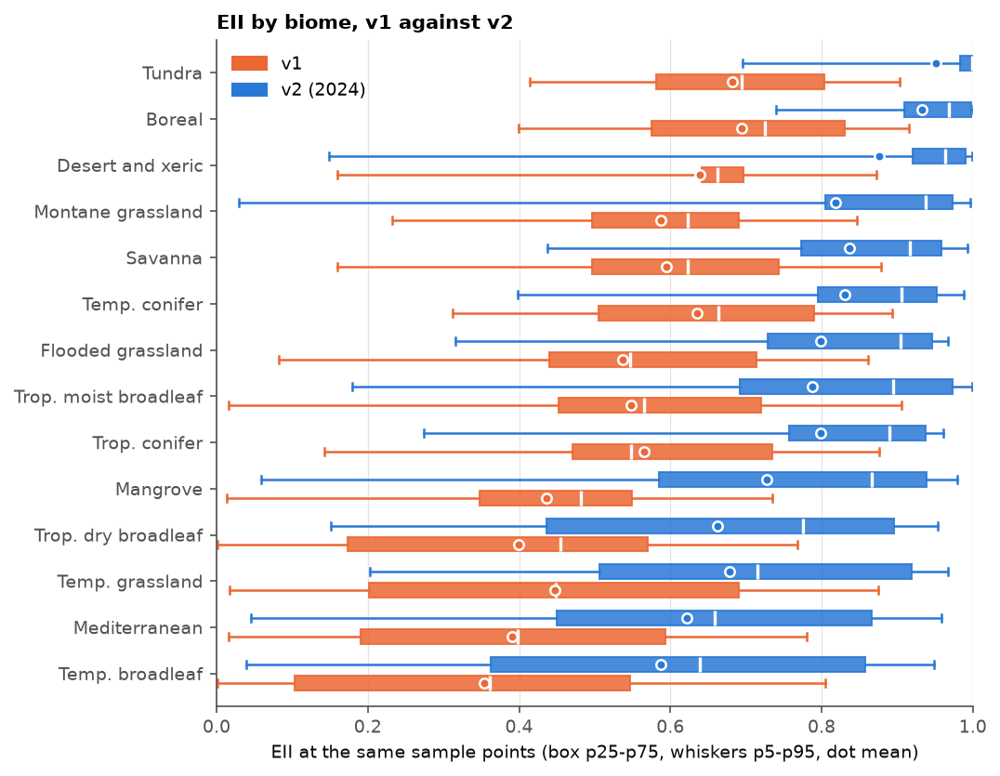

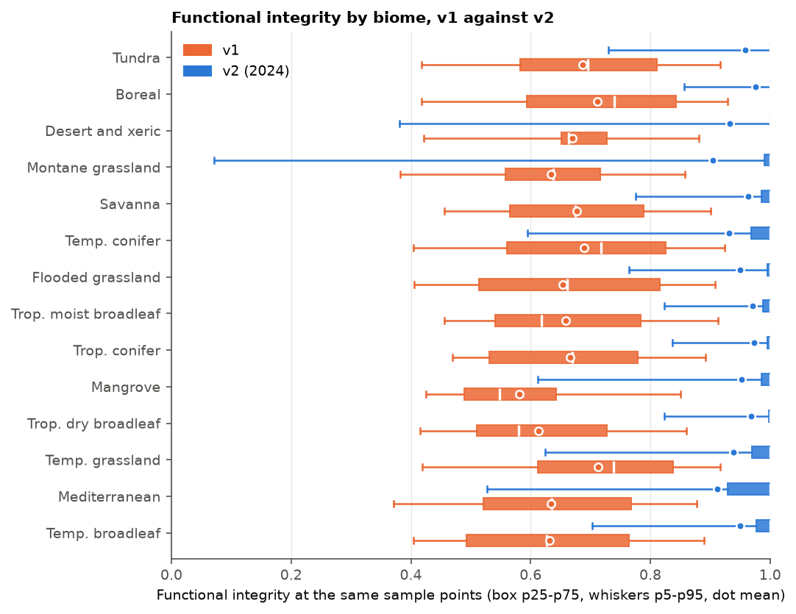

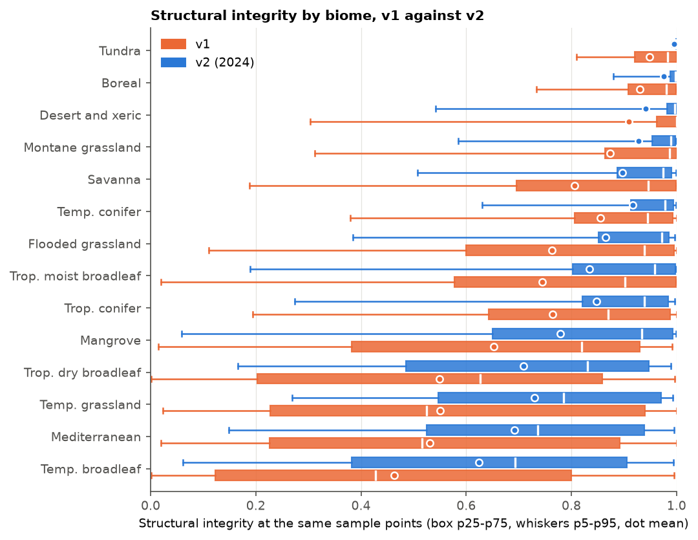

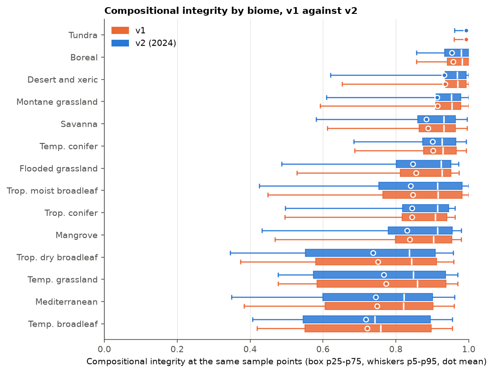

By component: functional integrity moves from medians of 0.55-0.75 to 1 in every biome (the
mean, the dot, stays at 0.90-0.98 because of the low tail). Structural integrity rises most in the
biomes with the most farmland: temperate broadleaf (median 0.43 to 0.69), Mediterranean (0.52 to
0.74) and temperate grassland (0.52 to 0.78). Compositional integrity is the same input family
(BII) in both versions and barely changes.

**Ranking within modified land changes most.** v1 structural integrity was close to 0 on most
agricultural and mosaic land, because core habitat needed HMI below 0.4. v2 follows HMI
continuously, so cropland scores a median of 0.45 in structure. Cropland EII goes from a median of
0.11 to 0.41. Built-up land stays near 0.

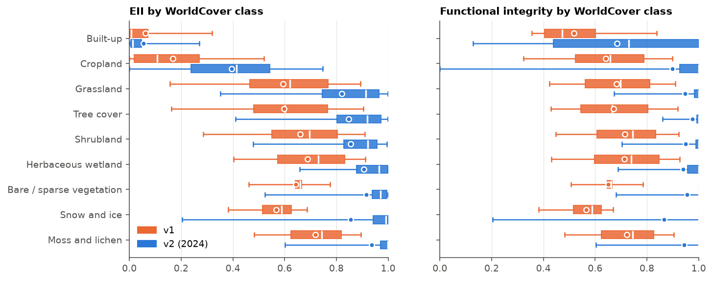

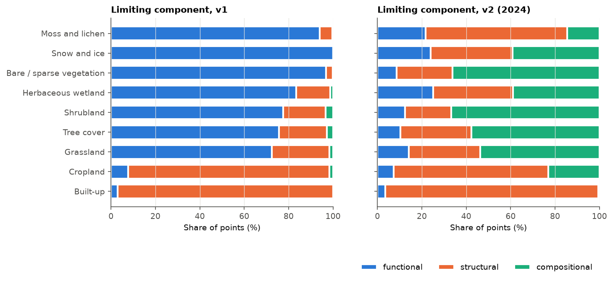

**Functional integrity rarely separates cropland from natural land.** 61 % of cropland points
score functional integrity 1. The exception is cropland in dry regions, where observed NPP is
well above the potential (median 2.2 times in the desert biome) and scores low as a surplus.

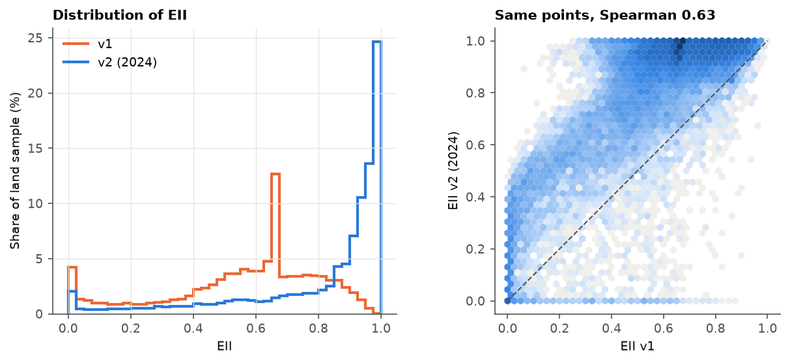

**Regional examples.** Central Europe, the US Midwest and the Cerrado, v1 against v2 2024. Blue
in the difference maps means v2 is higher.

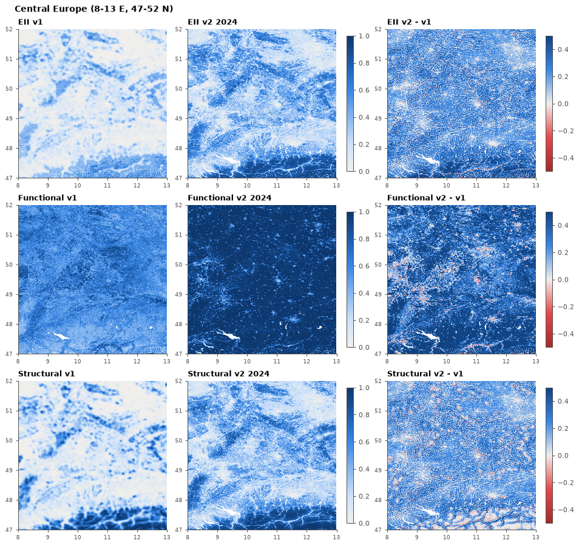

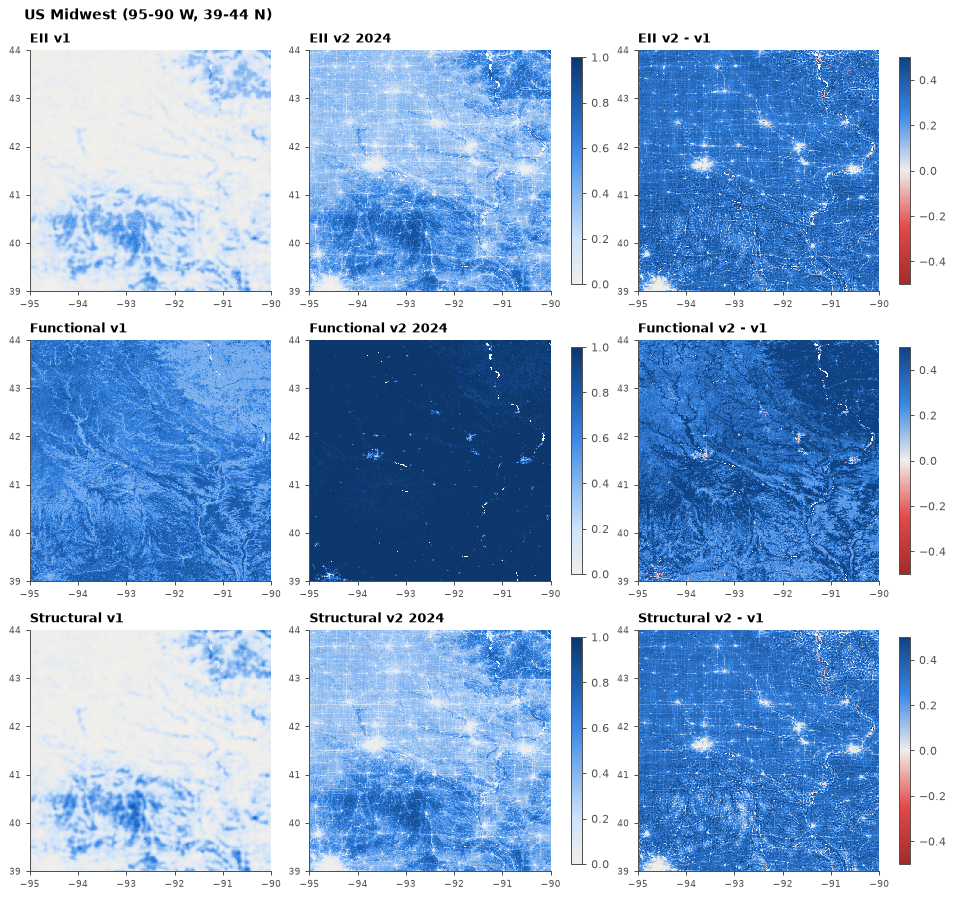

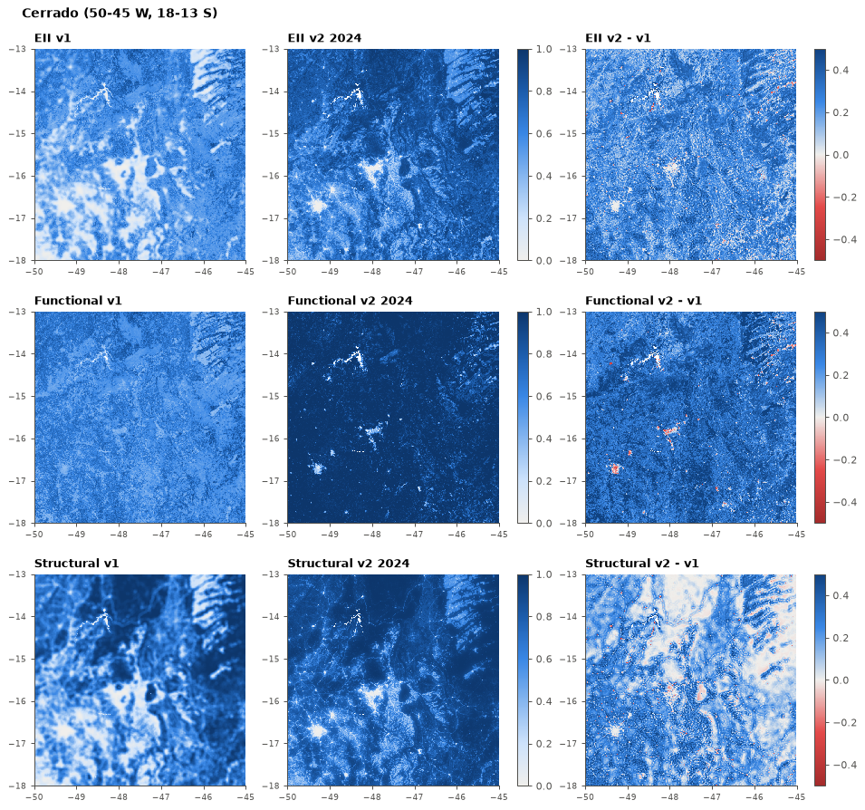

**Year to year.** v2 is annual. Between 2021 and 2025 the median EII per biome moves by 0.012 or
less, and by 0.019 in the Mediterranean biome.

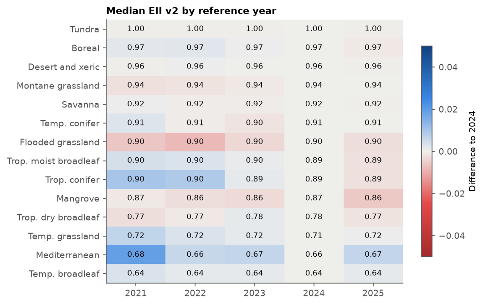
